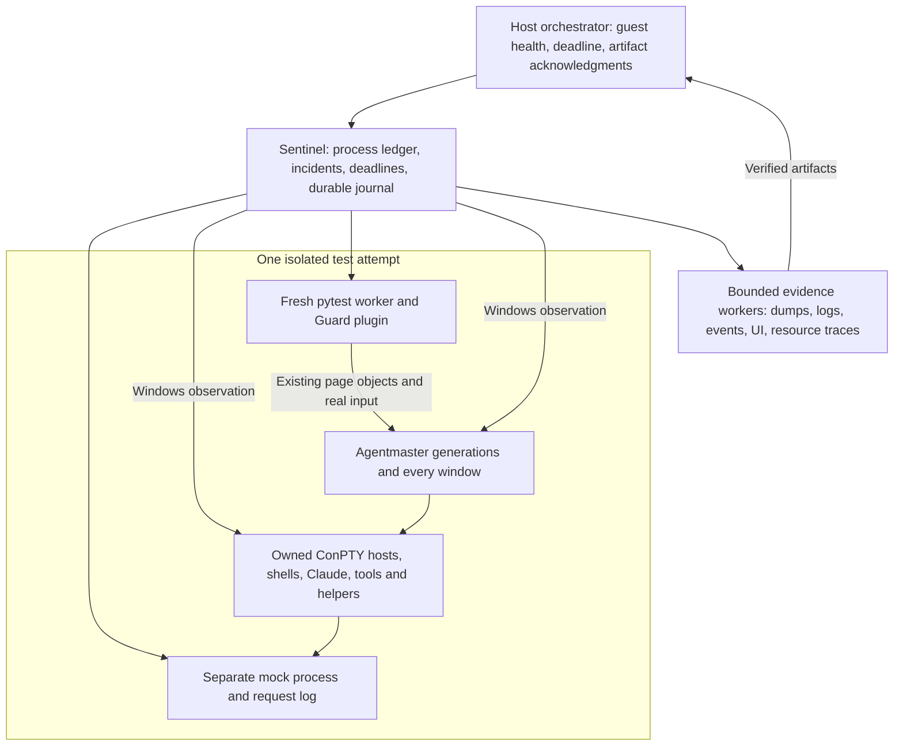

# E2E reliability: a guard around every test, and a dedicated failure suite

> **Planning only — 2026-10-23.** No implementation, build, installation, fault injection or test run is part of
> this change. Source baseline: `3773f7149` (40 E2E tests reported green against portable 0.8.0 and Claude Code
> 2.1.291). Another agent owns feature-scenario implementation. This document defines the shared reliability
> infrastructure and the special scenarios that implementation should use.
>
> **Owner decisions applied (2026-10-23): keep two documents (D0).** This document and
> [E2E_CRASH_GUARD.md](E2E_CRASH_GUARD.md) describe one implementation. The owner's D1–D17 correspond to that
> document's CG-D1–CG-D17; its §13 is the decision record, mirrored in §11 here. They are no longer unanswered
> recommendations. D15 remains unanswered; numerical resource and retention settings remain open as noted there.
>
> The user's requirement: “memory corruption, memory leaks and crashes as part of special scenarios suite” and
> “Crashes and memory corruption and sudden shut downs must be handled by every single test (single code running
> 'around' all) so we get clear signal on such a case.”

**Implementation direction:** put a mandatory reliability guard around the complete lifetime of every desktop test, backed
by a supervisor outside pytest and a watchdog outside the guest. Use that same guard for targeted lifecycle,
leak, corruption and recovery suites. Ordinary scenarios should not have to remember crash assertions. A process
exit, recovery restart, swallowed failure or broken monitor must never disappear behind a passing UI assertion.

This is the reliability extension to [E2E_TESTING.md](E2E_TESTING.md), especially §§7.6–8. It expands that plan's
original exclusion of memory measurements. [The flow catalog](flows/README.md) remains the behavioral contract;
[the existing driver](../../e2e/README.md) remains the scenario API. Proposed names and interfaces below do not
exist yet. The word **must** describes acceptance of the future implementation, not a capability already shipped.

The two documents have different jobs: [E2E_CRASH_GUARD.md](E2E_CRASH_GUARD.md) details the Guard, Sentinel,
Watchdog, concrete runner integration and GSF/SDN/CST/MCR/LKS/HMC scenarios; this document details observation
coverage, evidence validity, leak experiments and their acceptance. Use the same `e2e/guard/` implementation and
`guard.json` result, not two plugins. The decision record overrides the older recommendations in either plan;
this document's diagnostic/tool qualifications apply to the companion's concrete recipes. Scenario IDs are
cross-references and may share tests. There is no merge prerequisite before implementation preparation.

## 1. What success means, and what it cannot mean

Every desktop test gets four independently recorded results:

| Result | What it answers |
|---|---|
| Scenario | Did its requested behavior occur? |
| Reliability | Did an unexpected exit, native diagnostic, swallowed failure, stall, resource breach or leftover occur? |
| Observation | Were the required monitors alive and able to see the whole interval? |
| Evidence | Which artifacts were captured, verified and copied out; which were unavailable, and why? |

A test is green only when its scenario succeeds, its reliability contract succeeds, and its required observation
is complete. A recovery test can succeed after its **specifically expected** injected failure; that incident is
still visible in its report. A feature `known_defect`, skip, xfail or successful retry cannot suppress an unrelated
reliability failure. Preserve an earlier scenario assertion alongside later teardown or capture failures.

The final guest status, host process exit code and combined JUnit/report must reflect all four results, including
late incident revisions. Returning pytest's raw exit code is insufficient. Reconcile the collected test node IDs
against guard records and the plugin/supervisor handshake: any required missing interval/result makes the run
incomplete and nonzero, even if pytest returned 0. Preserve pytest's original report and add explicit reliability
failures rather than silently rewriting the scenario's assertion history. Publish final success only after the
supervisor finishes reconciliation and artifact acknowledgment.

Under D16, a required canary that fails is a **failed test and a nonzero run**, not an UNGUARDED warning. Its
dependent scenarios cannot run as qualified passes: mark them blocked/unqualified with the failing canary as
the cause. Independently qualified tests or bounded diagnostics may continue without clearing that failure.
Whether to stop all scheduling immediately is an implementation choice, not a separate owner decision.

This does **not** prove that no latent corruption or leak exists. An uninstrumented process can corrupt memory
without immediately crashing. Page heap, Application Verifier and AddressSanitizer each detect particular classes
in particular allocations/code. A finite soak can only bound growth for its exercised workload and sensitivity.
Reports must state the instrumentation and coverage, not certify “memory safe” from a green normal run.

Memory corruption, a retained allocation, expected cache growth, GPU/resource exhaustion, disk corruption and an
unexpected process exit are different observations. Do not label them all “crash” or all “memory leak.”

## 2. What exists, and the gaps the plan must close

The transcript's earlier “suite does not exist” description is historical. At the original review baseline, the
[E2E plan status](E2E_TESTING.md) and [runner README](../../e2e/README.md) record 40 tests. This review read the source;
it did not repeat those runs or establish the reliability of the published binary.

| Current implementation | Consequence | Required extension |
|---|---|---|
| [`suites/conftest.py`](../../e2e/suites/conftest.py), `am`: `app.start()` precedes the fixture's `yield` | A failing start never reaches that fixture's post-yield evidence/cleanup | Arm the guard and register finalization before any setup that can launch a process |
| Same fixture checks `app.alive()` and compares dump **names**, before `app.kill()` | Early failures, replaced dump files, delayed WER and shutdown failures can escape | Observe process generations continuously; reconcile evidence after shutdown and a bounded drain |
| [`App`](../../e2e/amdriver/app.py) uses `ended_by_test`; `close()` sets it before driving the close; `start()` replaces `proc` | A fault during intended close can be forgiven, and prior generations disappear | Retain every generation and use single-use, outcome-specific lifecycle expectations |
| `App.children()` needs the GUI to be alive | Discovery after a crash can lose the very children that became orphaned | Register ownership while alive; retain handles and identities after the parent exits |
| Leftovers are written to a text file, then killed; `_end_strays()` kills strays before a test | A suite may look green while each cleanup repairs a product defect | Record and fail leftovers before rescue; charge strays to the prior test or run setup |
| [`evidence.collect`](../../e2e/amdriver/evidence.py) runs collectors in pytest | A blocked UIA call can block reporting and cleanup | Independent, killable collectors, each with its own deadline |
| [`provision.ps1`](../../e2e/guest/provision.ps1) sets full WER dumps for Agentmaster, OpenConsole and Claude, `DumpCount=5` | Useful existing fallback, but not proof of capture or complete process coverage | Qualify collection per lane/image; archive promptly and track overwrites, ACLs and capacity |
| [`run_suite.py`](../../e2e/guest/run_suite.py) packages selected output files and test folders | The separate dump directory is not included; a dead pytest may produce no useful JUnit | Publish supervisor journals and referenced dumps independently; reconcile incomplete runs |
| [`e2e_run.py`](../../e2e/host/e2e_run.py) waits for run status and can delete in `finally` | An unreachable guest or failed export can lose the last evidence | Host heartbeat/deadline, incremental export, bounded final salvage, always stop VM when run ends (D17) |
| The mock server lives inside pytest | A wedged or dead pytest also removes the mock | Separately supervised mock owned by one test attempt, paired with its fresh worker (D6/D7) |
| E2E_TESTING §6's bridge/timing/AutomationId changes are proposals | A plan that requires their presence cannot protect today's suite | First guard uses Windows, existing files and current UIA; optional future hooks are explicitly separate |

### Actual failure history determines the coverage

* [MEMORY_LEAKS.md](MEMORY_LEAKS.md) documents the real 144-byte ICU `UText` clone leak from URL/Find scans, plus
  substantial legitimate XAML/DirectWrite/menu residency at approximately 700 tabs. Its observed periods did not
  cover repeated tab closure, window closure/reopen or Sessions-page churn. A raw memory threshold alone misses
  the former and mislabels the latter.
* [UI_THREAD.md](UI_THREAD.md) documents duplicate-conversation rebinds, overlay self-captures and repeated board
  construction. [CLAUDE.md](../../CLAUDE.md)'s Gotchas also record map-key use-after-free during rehome, input before
  terminal initialization, and final coroutine references destroying UI objects on a pool thread.
* A renderer can stop painting while hooks, the engine, the message pump and `IsHungAppWindow` still look healthy.
  A WER event can accompany a swallowed native fault with the same process remaining alive. An event is evidence;
  process death and rendered responsiveness need their own observations.
* [STARTUP_GUARD.md](STARTUP_GUARD.md) and `StartupGuard.h` cover a startup loader deadlock and a 25-second watchdog.
  The engine also has dispatcher-stall recovery/restart logic. A self-restart is a reliability incident during an
  ordinary test even if the UI returns and the test eventually succeeds.
* [`WindowEmperor.cpp`](../../src/cascadia/WindowsTerminal/WindowEmperor.cpp)'s shutdown path
  includes intentional process termination on normal shutdown. In particular the final shutdown uses
  `TerminateProcess(GetCurrentProcess(), 0)`. Therefore neither a zero exit code nor use of TerminateProcess alone
  classifies an exit. User intent, window/process scope, diagnostics and saved state matter.
* A `pwsh -NoExit` wrapper can outlive a dead Claude and leave the app's session state stale
  ([STA-11](flows/05-session-state.md), console-guard Gotcha). Monitor Claude independently of the GUI and its shell.

Some older doc sections still say NOT BUILT for changes later recorded as deployed. Capture the actual executable
hashes, matching symbols and capabilities; never infer the tested build's behavior from an old heading.

## 3. Three layers, with one policy



**Inside each test's pytest worker:** a mandatory plugin applies to every test under the desktop suites, including new files, setup,
teardown and tests that do not request `am`. Collection must reject a desktop test without the plugin. Pure mock
unit tests explicitly belong to a different scope. The plugin registers per-test contracts and forwards phase/action
markers; the existing `am` fixture becomes a client of this infrastructure. Direct alternate app launches must
register through the same lifecycle service. Parallel desktop tests in one interactive guest are unsupported;
parallelism uses separate guests.

**In the guest, outside every test worker:** the Sentinel owns durable process records, monitoring, jobs/handles,
the verdict journal and collector deadlines. It starts before the first worker and remains alive after the last.
A Python GIL lock, UIA COM hang, fixture
exception, `os._exit`, killed pytest or missing JUnit must not silence it. No UIA work runs on its monitoring loop.
Its own heartbeat and write failures are monitored by the host. It does not trust the app's self-reported state as
proof of survival or responsiveness.

**On the host:** monitor guest boot identity, supervisor heartbeats and an independent per-run deadline; persist
the current test and last acknowledged artifact manifest. Lost transport is initially `GUEST_UNREACHABLE`, not a
claim that Windows crashed. Fleet/hypervisor state, reboot identity and guest evidence refine the diagnosis.
Make bounded reconnect/collection attempts while the run is active. If the guest cannot be recovered, retain partial
host evidence and mark the interrupted test incomplete/nonzero. D10 does not authorize deliberate VM pause/reset/
reboot tests; passive detection of unexpected guest loss remains required. D17 ends the guest's running lifetime
when the run finishes, including failure. Never synthesize a pass from an absent status file.

One versioned policy classifies incidents and expected faults in all three layers. The guest does not contain a
second, weaker interpretation of what the pytest fixture means. Future helper and policy file names should live
under `e2e/guard/`, matching the companion plan; no product dependency on the runner is needed for the first phase.

### 3.1 Per-test process encapsulation (D6 and D7)

This is the concrete design interpretation of “some sort of encapsulation per process↔test,” not a claim the owner
selected a particular pytest extension. Use the existing subprocess/pytest machinery with one selected node id
per fresh worker. The Sentinel queues test attempts serially within a desktop; no general distributed scheduler
is required. A parametrized case or explicit retry gets a distinct attempt identity.

Each attempt owns its fresh pytest worker, app generations and their full descendant set, a separate mock process,
profile/config/work folders, mock gates/request log, and evidence namespace. A scenario with several windows,
sessions or app restarts keeps all those generations within the **same** attempt. The Sentinel and bounded capture
workers are outside the workload's termination boundary but record which attempt they serve. No worker, mock
process or mutable scenario state is reused by the next attempt; only immutable builds/tools/fixtures may be cached.

Order: allocate identity and monitor coverage → start/register mock and verify readiness → start/register one test
worker → exercise and gather results → capture on failure → stop worker/workload with natural child drain first →
stop that attempt's mock/collectors and verify no owned survivors → export/reconcile → schedule the next attempt.
Keep the mock alive during bounded failure capture so its evidence survives worker death. An unexpected mock exit
fails that attempt; silently restarting it inside the same attempt must not erase the failure. A deliberately
tested mock outage uses the normal narrow expectation contract.

The Sentinel retains job/process handles across worker death: closing the worker must not kill the app before
evidence collection. It eventually enforces containment after the bounded capture/drain, including tool descendants.
Its own loss is a separate host-monitored failure; qualified kill-on-final-job-handle-close is a last-resort cleanup,
not the normal way to end an attempt. Before starting the next item, require a clean ownership ledger and endpoint
drain. If the next item cannot be isolated, stop scheduling it and fail the run. A lost worker remains failed in
the aggregate; continuing with later fresh workers is not a retry that turns the lost test green.

## 4. The guarded lifecycle

| Phase | Required work before proceeding |
|---|---|
| Preflight | Validate isolated guest/build/profile paths; monitor permissions; time/boot identity; free disk/commit; collector mode; event bookmarks; no unexplained prior processes; publish run manifest |
| Arm | Allocate unique run/test/attempt id; persist contract and finalizer; start observation **before setup**; publish monitor-ready acknowledgment |
| Setup/start | Register launch before executing it; retain the process handle immediately; watch startup even if no window or profile log ever appears |
| Exercise | Record action/phase begin/end, process and window changes, expected exits, resource samples and diagnostic/log events; interrupt scenario work on a fatal incident |
| Quiesce | Stop new UI actions; keep observation live; capture the last healthy state and the first-failure evidence |
| Teardown | Perform the declared close/quit/kill operation; observe all generations and children through their drain; report any forced rescue separately |
| Reconcile | Await bounded late diagnostics/dump completion; resolve or expire every expectation; verify no owned survivors and no monitor gaps |
| Commit/export | Write scenario and guard results atomically; bounded export and hash verification; missing evidence makes the run nonzero. No mutable state reuse; final VM shutdown follows §8 even if export failed |

Every failure path uses the same finalizer, including a failed setup or evidence worker. No evidence operation can
block progress forever. An overall deadline is enforced by the supervisor even if pytest is unable to execute
its own timeout. A hard kill performed by the harness to unstick a failed run is a **cleanup action following a
failure**, never evidence that the original exit was expected.

### 4.1 Process and window identity

The ledger records guest boot id, PID, process creation time, canonical image path and hash, generation number,
role, owner test, observed parent identity, profile/config association, and open process handle where permitted.
Use `(boot, PID, creation time)` to avoid PID reuse. Keep exit code as an unsigned 32-bit hex value **and** the
original numeric representation. A process handle becoming signaled establishes exit; a later table poll is not
needed to prove that a previously registered process existed. Windows exposes signaled process handles and exit
codes ([process termination](https://learn.microsoft.com/en-us/windows/win32/procthread/terminating-a-process)).

Do not discover children only after the parent dies. Combine process-start/stop observation with periodic census
and retained handles; record discovery loss/overflow. Use lineage plus the isolated layout/config and console/tab
association to separate owned processes, deliberate external-session fixtures and OS services. Ordinary short-lived
hook/tool processes may exit normally; long-lived roles have explicit lifetime contracts. A nonzero tool exit
scripted by the mock is not automatically a native crash. A WER fault in that tool remains a distinct incident.

Agentmaster's windows share a process. Closing or tearing out one window is not permission for that process to
exit; moving a tab is not permission for its Claude to restart. Launcher handoff processes, helper replacements
and updater successors need their own roles. Unexpected new GUI generations are detected even if the old PID was
gone before the next UI action.

Very short-lived processes can evade a polling-only observer. Qualification must measure this blind spot. Require
a reliable process-event source for full child coverage; when denied or events are lost, report reduced coverage,
not “all children monitored.” In elevated/packaged lanes, qualify access and instance handoff separately.

Use a qualified per-attempt Job Object for the workload's containment, with ownership and handles retained by the
Sentinel; job notifications alone are not the liveness authority. Assignment/inheritance can change ConPTY, child
jobs and breakaway behavior, so qualify those paths and separately register escapes such as packaged activations.
Do not kill the job before observing natural child drain and capturing evidence. Keep the observer outside any
job being killed. Supplement job notifications
with retained handles: Microsoft explicitly does not guarantee all job completion-port notifications
([Job Objects](https://learn.microsoft.com/en-us/windows/win32/procthread/job-objects)).

### 4.2 Expected exits are narrow contracts

Replace the global `ended_by_test` exemption with a supervisor-acknowledged, single-use expectation. It names:

* The test, action and current process identity/generation; the window or session involved.
* The reason: close one tab, close one window, quit all, session restart, deliberate process kill, expected
  watchdog recovery, updater replacement, or a particular synthetic diagnostic.
* A short activation interval and maximum count; allowed exit outcomes; required survivors and successors.
* Required evidence and postconditions, including saved workspace, process drain and resumed conversation.

Persist and acknowledge the expectation **before** sending the close click or kill. A cancelled/failed close
revokes it. A normal-close expectation allows the specified clean outcome only; it cannot excuse an AV,
heap-corruption event or fast-fail during that close. A child exit may be expected as a consequence of a parent
shutdown, but a diagnostic in that child is not waived. Do not blanket-allow all descendants or all exits in a
teardown time range.

A deliberate corruption canary has a different contract: exact helper image/hash, identity, fault kind and count,
expected diagnostic, and deadline. Expecting “some nonzero exit” is insufficient. An unobserved injected fault is
a detector failure. An extra fault, wrong target, unexpected surviving process or unrelated app crash fails.

### 4.3 Timing and attribution

Use a monotonic clock for intervals and UTC plus boot/sequence identifiers for correlation; preserve original log
timestamps. `hooks.log` uses local time without a full date, so use run timezone, file identity and byte offsets,
not textual time alone. Track truncation/rotation and byte ranges. Bookmark Windows event channels instead of
clearing machine logs. Correlate delayed events using process identity, image, event time and dump metadata;
never assign every new `.dmp` to whichever test happened to finish last.

Proposed initial budgets, to be calibrated on the disposable guest and then versioned: handle/event processing
within 2 seconds; resource sampling every second; action liveness observations every 1–2 seconds while interactive;
30-second normal shutdown drain; 30-second late-WER reconciliation; lightweight collector deadline 5 seconds and
full dump deadline 120 seconds. Startup and each long operation have their own declared budget. Instrumented
lanes get explicit budgets, not silent retries or automatic relaxation. The existing 25-second startup watchdog
and multi-minute dispatcher-restart flow must fit their dedicated scenarios' outer deadlines.

Late evidence beyond a test's drain remains monitored until the run ends and may revise that test's result.
Publication waits for final reconciliation; revisions are append-only. A final quiet interval cannot prove that
Windows will never publish a later event, so any unresolved incident remains explicit.

## 5. Detectors and verdicts

The categories below explain detection coverage; they are not a second wire-format enum. The canonical report
kinds are [E2E_CRASH_GUARD.md §5.6](E2E_CRASH_GUARD.md#56-classification): exits map to `SUDDEN-EXIT`/`STARTUP`/
`SELF-RESTART`, native faults to `CRASH`/`CORRUPTION`, swallowed exceptions to `SWALLOWED`, stalls to `HANG`,
resources to `RESOURCE`, survivors to `ORPHAN`, missing coverage to `BLIND`, and interrupted infrastructure to
`RUNNER`/`MACHINE`. Evidence retains the precise signal and whether the target actually died.

| Signal | Classification and action |
|---|---|
| Registered required process exits outside its contract, including code 0 and no dump | `UNEXPECTED_EXIT`; stop scenario, preserve evidence, identify role/generation. Cause may remain unknown |
| Unhandled/last-chance exception or fast-fail; heap-corruption report, verifier stop, ASan report, or verified unallowed first-chance corruption diagnostic | `NATIVE_FAULT` with code, chance, subcode, module and lane; fail unless the exact synthetic fault was expected. Handled first-chance AVs follow the qualified policy below |
| WER event/dump but process remains alive | `NATIVE_DIAGNOSTIC`; retain exit-alive distinction, fail on a verified unexpected native failure; probe visual/functional recovery. Known defects do not waive it |
| Any unexpected `[exc]` or `[wil] exception` line, known or new | `APP_DIAGNOSTIC` / canonical `SWALLOWED`; **fail** (D1), preserving full context and stack. A defect id groups incidents and cannot downgrade them |
| Unexpected `[persist-fail]`, `[launch-fail]`, `[ui-stall]`, startup/recovery watchdog event | `APP_DIAGNOSTIC`; fail under the corresponding DATA/STARTUP/HANG/SELF-RESTART policy. Recovery does not excuse a wedge (D3) |
| Required process exists but declared action makes no observable progress | `HANG_OR_STALL`; collect bounded snapshots before intervention; distinguish UI, renderer, session and mock |
| Repeated resource growth beyond a qualified contract | `RESOURCE_GROWTH`; use §7 to distinguish confirmed leak from unexplained retention or capacity failure |
| Any test-owned process survives natural drain, or unexpected owned process appears after quiesce | `ORPHAN_OR_LATE_WORK`; **fail**, including `bash`, `node`, MCP servers and other tools (D4). Never charge/kill unrelated external processes by name |
| Monitor died, access denied, event buffer overflow, UI probe/capture service unavailable, collection deadline missing | `OBSERVATION_GAP`; required coverage incomplete, never green |
| Guest/runner vanished or host deadline elapsed | `RUN_INTERRUPTED`; preserve partials; classify product vs infrastructure only with evidence |

Retain all incidents and their chronology. Select the primary report kind through the companion's shared policy,
with causal evidence so a cleanup consequence cannot replace the original failure. A missing dump is
an evidence limitation, not grounds to discard an exit or crash. No crash can be automatically downgraded because
the scenario is already marked known-defective. Exact expected faults in special tests are the sole exception.

A Claude crash in a feature test **fails** (D2). Identify the failing role as Claude; attribute a cause to Claude,
the mock or Agentmaster only when the evidence supports it. A declared tool command returning an expected failure
code remains distinct from its process crashing. A required canary's failure is never softened to a warning (D16).

### Native diagnostics need context

Do not translate `0xC0000409` directly into “stack buffer overflow”: fail-fast subcodes include fatal app exit;
the known coroutine/destructor incident used subcode 7. Preserve exception parameters. Do not call every
`0xC0000005` a use-after-free without stack/allocation evidence. Preserve the original dump for later analysis.

First-chance exceptions arrive **before** application handlers; many are handled. Failing on every C++ throw or
attaching a debugger configured to break on every exception will manufacture failures. Use second-chance and
specific verified corruption diagnostics by default in debugger lanes. In a diagnostic first-chance lane, severe
events receive a versioned exact-signature policy; every new signature is investigated. MSVC ASan itself can use
handled first-chance AVs for shadow memory, so that lane needs its own policy (official sources in §12).

The app already logs swallowed exceptions with raise-site stacks through `ClaudeSpawn.cpp` and
[`AgentCatchLog.h`](../../src/cascadia/TerminalApp/AgentCatchLog.h). Read from pre-action marks and include the
throttle/suppression context. Its logging path is best-effort and intentionally cannot log its own failures;
absence of `[exc]` is not proof that nothing failed. A missing begin/end log pair is a clue, not an independent
proof of crash: missing logging and hangs are also possible.

D1 rejects a known-signature allowlist that would forgive app-reported swallowed exceptions. Such signatures may
carry defect ids for attribution but still fail. This is distinct from identifying benign **handled first-chance
debugger events** that never constitute an app error, such as a qualified ASan runtime mechanism. That detector
policy must be exact and reviewable (code, stack/context, build/lane, reason, expiry/count), and cannot override
D1–D4. Keep raw evidence. Only a deliberately injected, exact, bounded expected incident in a special scenario
is permitted by §4.2; there is no broad warning-only mode for known app faults.

### Responsiveness has several independent dimensions

1. **Process:** identity still exists; no replacement generation appeared.
2. **Dispatcher/window:** every relevant visible window answers a bounded probe. UIA work runs in an expendable
   worker; cached UIA properties or `WM_NULL` alone cannot certify application progress.
3. **Behavior:** the scenario's current action reaches its named condition: selection changed, a prompt reached
   the mock, a terminal rendered a distinctive response, a menu opened, or a persistent change appeared.
4. **Presentation:** for an operation expected to change the screen, a targeted visible crop shows that change.
   Combine with UIA/terminal text; a static idle screen is not a hang, and an updating cursor is not proof the
   rest of the window repainted. Record occlusion/minimized/locked-session state before judging pixels.

Ordinary tests use the actions they already perform; the guard must not steal focus or type unsolicited probes.
Dedicated freeze tests schedule explicit harmless visible transitions and verify them in **every** window.
The engine's dispatcher heartbeat is supporting evidence, not a substitute for this external check. Genuine
renderer coverage depends on a functioning guest display capture path; diagnose that path independently.

## 6. Instrumentation lanes, selected rather than piled together

Every lane keeps the universal guard. Instrumentation adds detection; it never replaces the shipped-binary run.

| Lane | Target and workload | What it contributes | Boundaries / qualification |
|---|---|---|---|
| Normal | Exact released/candidate executable; all desktop scenarios | Exits, WER, app diagnostics, stalls, child leaks, coarse resource trends | Does not catch silent arbitrary memory corruption |
| Lifecycle soak | Same binary; repeated fixed workloads and long runs | Retention slopes, lifecycle leaks, late races, UI/GPU resource accumulation | Compare equivalent settled states; do not conflate elapsed time with operation count |
| Verifier + page heap | Isolated guest; selected high-risk scenarios; existing native binaries | Invalid heap/handle use and corruption nearer the cause; full page heap protects allocation boundaries | Qualify exact Win11 build, heap kind and modules; large memory/timing overhead; smaller fleets |
| ASan | Separately built instrumented native modules plus matching runtime/PDBs | Heap/stack/global bounds errors, use-after-free and supported lifetime faults | Direction accepted by D9; feasibility first, separate layout and build permission still required; coverage gaps recorded; not leak detection |
| Heap/ETW investigation | Matched control/treatment actions with supported WPR heap or UMDH allocation stacks | Allocation-site growth and resource attribution | Select a validated heap/tool pairing; instrumentation changes behavior and trace volume |
| Fault/recovery | Shipped binary where possible; explicit test hooks only where necessary | Whether detectors see faults and the app restores usable, durable state | Every injection scoped to owned disposable processes/storage; expected-fault contract required |
| Hardware/rendering qualification — deferred | Would require a separate isolated Windows desktop with relevant GPU/driver | Failures the software-rendered/QEMU guest cannot reproduce | Outside the current preparation scope; VM WARP success makes no claim about the historical NVIDIA defect |

### 6.1 Crash capture

Keep WER LocalDumps as the normal lane's passive fallback, scoped by image name with explicit dump path/ACLs and
capacity. Verify the actual GUI filename and every long-lived helper in the lane, including native search/CLI
helpers when exercised. Keep the app, Claude and OpenConsole faults separately owned. Windows documents that
LocalDumps does not collect when automatic crash debugging is configured; do not assume WER and debugger capture
will both work. See [WER LocalDumps](https://learn.microsoft.com/en-us/windows/win32/wer/collecting-user-mode-dumps).

A qualified ProcDump or small external snapshot collector provides live/hang dumps and debugger-lane fault
capture. ProcDump's exception, termination, hang and clone options have different effects; pin its version and
test the selected mode rather than giving every test every trigger. Termination snapshots help only while the
target can still be captured; a process already killed cannot be dumped retroactively. Existing
[`tools/leakhunt/snapdump.cpp`](../../tools/leakhunt/snapdump.cpp) uses a PSS snapshot and is a useful candidate for
heap comparisons, not a guarantee of zero pause or zero additional commit. Full dumps of large fleets can be
gigabytes. Capture one decisive artifact before exhausting the guest with duplicates.

At each image/tool/lane change, a synthetic crashing helper must demonstrate capture, correct ownership and
symbolization end to end **for that helper**. Separately verify the real target's effective per-image configuration,
access context, dump-folder permissions, crash-reporter/debugger interaction and symbol identity. Keep target-image
crash capture explicitly unqualified until exercised in a controlled disposable run; the helper alone cannot
certify Agentmaster's WER path. Test explicit TerminateProcess separately: Windows may produce neither an exception
dump nor a WER event. The process ledger must still fail that test when the termination is unexpected.

### 6.2 Corruption qualification

Application Verifier/PageHeap settings are normally image-scoped and take effect on subsequent launches. Keep
all targets inside the disposable guest, record active settings before launch, verify they took effect, and
restore instrumentation settings or provision a clean guest between lanes. Never apply image-wide settings on the
user's workstation. Start with
Agentmaster and owned DLLs; instrument OpenConsole or external native tools in separate lanes so an upstream
failure is not misattributed. Full page heap is not suitable for a 700-active-tab capacity test.

D10 does not approve a compulsory 12–16 GB guest. Begin with small workloads on the configured VM, check headroom,
and report a capacity block if an instrumented case cannot fit; do not enlarge the VM or add machine stress by
implication. D15 is unanswered: preserve Defender's existing settings. If a tool is blocked, report that unmet
prerequisite; do not automatically add exclusions or turn Defender off.

A helper proves the tool works on its allocator; it does **not** prove coverage of every heap in Agentmaster.
Inventory NT/segment/custom heaps and instrumented modules. Qualification must show where settings change heap
selection, where stacks are recorded, and what remains unobserved. Do not silently disable the segment heap or
declare it supported without measurement. Keep ordinary segment-heap runs as a separate baseline.

MSVC AddressSanitizer is an accepted direction (D9), with feasibility first for the native solution, not a single
asserted build flag. Each build still needs the normal permission and its own layout slot.
Determine supported projects and dependencies, XAML/generated-code constraints, incompatible options and runtime
deployment. Microsoft documents no MSVC LeakSanitizer, limitations for UWP, and uninstrumented resumable functions
including coroutines. Agentmaster's coroutine teardown risk therefore still needs lifecycle stress and other
diagnostics. Publish the exact module/function coverage; a partial ASan build is useful but cannot imply whole-app
coverage. ASan, PageHeap and Verifier initially run separately; combine only after a measured compatibility gate.

## 7. Memory and resource leaks: make the experiment discriminating

### 7.1 Lightweight safeguards on every test (D11/D12)

Reuse existing OS/VM counters rather than building a resource-management subsystem. Sample each owned long-lived
process independently: private committed bytes, working set, thread count, handles,
CPU and I/O deltas; add GUI GDI/USER counts and supported GPU budget/usage observations where available. Also record
guest commit used/limit, available memory and evidence-volume free space. Python/mock growth must remain separate
from Agentmaster, OpenConsole and Claude growth. Summing working sets double-counts shared pages; label every metric.

Use simple configurable headroom/capacity tripwires and explicit missing-capacity results. Exact thresholds remain
open. The former proposal to run every test five times and set soft/hard limits to maximum ×1.5/×4 is **not approved**
and is not a prerequisite for the initial guard. Do not add automatic recalibration, auto-resizing or a scheduler
that negotiates machine resources. Keep measurements for later analysis in each `guard.json` (D14).

Short tests use these measurements for gross runaway/resource-budget detection and context. They do not receive
a “no leaks” certificate from a start/end delta. Working set can fall after trimming even with leaked allocations;
private bytes can stay high after frees because an allocator retains pages. Do not call `EmptyWorkingSet`, force
an artificial cache purge or restart midway to make a leak test pass.

A safety ceiling being crossed can fail as RESOURCE/runaway; a modest resource increase is diagnostic only. Do not
call a soft overrun `LEAK-SUSPECT` or infer a leak from one ordinary test. Leak verdicts come from the dedicated
repeated-action experiments below (D12). Their noise/sensitivity calibration is necessary measurement work,
separate from the unapproved general per-test budget engine.

### 7.2 A repeatable leak experiment

1. **Declare the workload.** Version the corpus, terminal dimensions, enabled surfaces, number of live/dormant
   tabs, window count, transcript/history size, renderer, tool versions and process roles. Define the resource
   that should be released and its legitimate retained state. Predeclare warm-up, batches, grace and budgets.
2. **Warm once.** Exercise the same surfaces/paths enough to initialize fonts, XAML templates, menus and lazy
   caches. Take baseline samples after the agreed settling conditions. Do not choose a later baseline after
   seeing a bad trend.
3. **Exercise and settle repeatedly.** Initial small lane: 10 warm-up cycles, then 10 batches of 10 operations;
   longer/nightly lanes scale the operation count and time. Record allocations/counters at comparable checkpoints
   after each batch. Waiting has an upper bound and names pending work; a plateau may itself never arrive in a leak.
4. **Compare equivalent states.** Restore live window/tab/selection counts through real UI. Prefer reopening the
   same sessions/corpus, rather than minting unbounded history. Closing sessions intentionally preserves records;
   if a workload necessarily grows transcripts or the registry, measure that growth separately using a matched
   control with the same durable data. Never erase the profile under a running app to fake equivalence.
5. **Attribute.** On repeatable growth, compare at least baseline/mid/end live-heap snapshots or allocation-stack
   traces; locate outstanding objects/bytes by owner and expected lifetime. A positive private-byte slope without
   attribution is `UNEXPLAINED_RETENTION`, not yet a proven leak. It may still fail a capacity budget.
6. **Confirm and release.** Repeat in a fresh process/guest with the same seed, compare to the baseline build,
   then close the owning surface/tab/window and remeasure. A workaround that frees only at whole-process exit
   does not satisfy a per-window release contract. Save the full series, not just its fitted slope.

### 7.3 Growth and pass criteria

Use cycle count **and** wall time: an event leak can be small per hour when a test is idle, while a background leak
can be small per cycle in a fast test. For each metric report baseline, settled samples, peak, end residual, bytes
or objects per operation and per minute, workload cardinalities and uncertainty. Use a robust slope across batches
and multiple fresh-process replicates; do not treat adjacent 1-second samples as independent replicates.

A versioned budget has two parts: an absolute capacity ceiling (guest safety/product target) and a retained-growth
ceiling after warm-up (operations/time). Calibrate noise with a no-op/matched-history control and known-good build;
publish the detectable leak size. Require the uncertainty bound to fit within the accepted tolerance for a pass;
an inconclusive short run extends or remains inconclusive. Repeated excess slope/endpoint residual fails even if
the process has not exhausted memory. Concrete byte limits belong to measured workload/build/OS baselines; inventing
one universal “+50 MB is fine” number would defeat both small leaks and legitimate caching.

For the known UText case, use the targeted closed-clone/live-allocation signature and 144-byte growth expectation
to prove sensitivity to the historical defect; a small helper proves the detector and the actual URL/Find workload
proves the app path. For XAML use live object counts/owners (Tab, page, overlay/grip, columns, menu, tooltip) alongside
memory. An expected live count is an invariant only after checking cached/dormant owners and COM release delays.

[`tools/leakhunt`](../../tools/leakhunt/README.md) is reusable analysis infrastructure, with qualifications:

* Raw vftable/magic-byte hits include freed memory. Compare **live allocations**, not raw hits in a single dump.
* The segment-heap walker previously misread the Windows 26200 LFH bitmap and halved live counts. Pin supported
  OS build/layout; validate against known live counts, heap totals and independent debugger/tool evidence. On an
  unknown layout, disable that conclusion and report unavailable analysis; never turn parser failure into zero leaks.
* UMDH/UST and WPR heap traces need allocation stacks enabled before the target allocates. Custom/segment heaps
  and third-party allocators require explicit qualification. Keep `VirtualAlloc`, handles and GPU resources in
  the census because a heap-only trace is not complete resource accounting.
* Snapshot collection itself consumes time, disk and commit. Measure its overhead in the control, and sample at
  defined checkpoints; do not take a full dump every second.

### 7.4 Capacity without endangering the runner

Use distinct workloads: small active fleet; many dormant/restored tabs with few active sessions; active-terminal
renderer churn; and long-duration modest-fleet soak. Start at 1/10/50 tabs, and raise dormant counts to 100/300/700
only within a measured guest budget. Hundreds of real Claude processes cannot be assumed to fit the existing
configured guest (the current host runner defaults to 8 GB and 6 CPUs; older planning text assumed less). Test
overflow gracefully rather than accepting a host/guest OOM as a useful leak measurement.

Stop work early at the recorded safety reserve for guest commit and evidence storage, preserving a pre-failure
dump and samples. Report `RESOURCE_BUDGET_EXCEEDED` or infrastructure shortage with evidence; never pass because
the run stopped early. Keep the supervisor, paging capacity and dump output outside any intentionally constrained
storage/allocator. A process-job memory cap changes semantics and is a separate fault lane, not the leak baseline.

## 8. Evidence survives the failure it describes

Keep a compact manifest and **`guard.json` for every test**, even a pass (D14). Keep heavier artifacts on failure,
at prescribed leak checkpoints and in a sampled success control. A pass without a guard interval, monitor status
and registered process generations is not auditable.

Proposed result layout under the existing run's output directory:

```text
manifest.json                      build, guest, tools, lane, policies, capabilities
run-events.jsonl                    append-only supervisor/host journal
tests/<node-hash>/<attempt>/
  guard.json                       scenario, reliability, observation, evidence results
  actions.jsonl                    phase/action intent and completion; expectation ids
  processes.jsonl                  identities, generations, ownership, births/exits
  incidents.jsonl                  first signal, classification, related artifacts
  resources.csv                    time, role/generation, counters, workload checkpoints
  artifacts.json                   sizes, hashes, completed/partial/missing reasons
  logs/ events/ state/ transcripts/ mock/ screen/ dumps/ traces/
```

Use the full pytest node id plus a stable hash and attempt id. Today's truncated function-name folder is not a
safe identity for parametrized tests, retries or two files with the same function name. Persist the manifest
before startup and update through atomic replacement; an interrupted JSONL tail is recoverable, never interpreted
as a completed result. Export small journals/heartbeats incrementally to the host, not only in the final zip.

The minimum useful incident bundle contains:

* First-failure time, test/phase/action, active expected-fault contract, process/window/session identities,
  raw exit/exception values and the sequence preceding the failure.
* Original Windows event records or exported event range, dump metadata and **actual dump files** if available;
  classify crash dumps separately from intentional hang/leak snapshots. Wait for a bounded completed file, rather
  than packing a half-written `.dmp` because its filename appeared.
* Exact binaries and matching PDB identity (GUID/age), source commit, hashes, build flavor/compiler flags, module
  list, OS build, package identity, renderer/driver and Claude/tool versions. Keep binaries/symbols once per build
  and reference them by hash. A newer PDB from the same path is not a substitute.
* Pre-failure bounded resource history and logs, profile/window records, mock request log, transcripts and the
  last successful UI/terminal state. Logs without profile state cannot establish workspace recovery.
* Best-effort screenshot and UIA/terminal state when accessible; if the app is dead, still collect desktop state,
  remaining processes, events and files. State exactly which collectors timed out or lacked permission.

**Symbols (D8):** every public open-source release is to publish its matching PDBs; another agent owns that release
packaging work. Testing consumes the matching public symbol artifact and verifies binary/PDB identities. This plan
does not implement publication or treat private CI-only symbols as the desired release policy. A historical zip
without symbols remains usable for explicitly labeled limited diagnosis, but cannot satisfy a lane that requires
source-level symbolization. Keep its failure nonzero/unsymbolized rather than pretending matching symbols exist.

Capture order is adaptive: flush the tiny incident/identity record first; then the diagnostic needed before the
target disappears; then independent files/events; finally UI and expensive analysis. On hangs, take two time-spaced
thread snapshots if capacity permits, preserving whether threads made progress. Each worker has a timeout and a
separate process; DbgHelp calls are serialized in its worker. Do not suspend a target indefinitely while waiting
for a collector. Do not use `tools/livesample.exe` as routine monitoring. Microsoft recommends external dump
creation because in-process dumping can deadlock in a damaged process
([MiniDumpWriteDump](https://learn.microsoft.com/en-us/windows/win32/api/minidumpapiset/nf-minidumpapiset-minidumpwritedump)).

Record debugger ownership and intentional suspension intervals. Instrumented timing contracts can account for a
declared snapshot pause, but a timed-out capture is a collection failure, not unlimited permission to ignore a
stall. The app's existing startup/dispatcher watchdog behavior changes when a debugger is attached; validate
watchdog recovery in the normal lane, separately from debugger diagnostics.

PSS clones need an explicit collector-owned role. The existing helper's clones use the target's image and name
the target as parent, so they must not be mistaken for restarted GUIs or ordinary app children. Before capture,
register its operation; as soon as a clone exists, hand its exact identity/handle to the supervisor. Verify that
the clone terminates after capture. If the collector hangs/dies before that handoff, reconcile against the
pre-capture process census and operation metadata; do not exclude every same-image or zero-thread process. The
existing `snapdump.cpp` explicitly terminates its clone because freeing a PSS snapshot once left a large orphan.
Killing the dump worker can skip that cleanup: the supervisor must independently terminate the verified clone,
wait for its handle to signal, and report resource/cleanup failure if it survives. Add collector death both before
and after clone registration to G-09. Never apply a broad image-name kill to solve this case.

Symbols/analysis may be unavailable without erasing a confirmed crash. Mark it “fault detected, unsymbolized.” A
required corruption-lane dump missing its diagnostic record fails that lane's observation contract. Cap duplicate
dumps per incident, keep the earliest decisive dump plus prescribed comparisons, and record quota exclusions.
Never delete an unexported incident to make room for a later pass. Full dumps contain process memory; seed only
synthetic credentials/transcripts and keep dumps out of Git and public CI artifacts.

**Retention (D13):** add an explicit host-side cleanup policy under `Q:\agentmaster-e2e\runs`. Configure age and
storage/dump caps, record deletions and preserve small verdict/manifest records when heavy artifacts expire. Protect
active runs and in-flight exports, restrict cleanup to validated run-root paths, and retain known failure evidence
according to the configured policy rather than accumulating dumps indefinitely. The proposed **30 days / 20 full
dumps per run remain unconfirmed values**, not an owner-approved requirement. Select and record bounded values
before enabling unattended retention; retaining data is accepted, its exact numeric policy is still open. Public
PDB publication does not authorize public upload of private memory dumps.

After export, the host verifies manifest checksums and artifact sizes before acknowledging completion. Compression,
copying and final salvage have their own disk reserve/deadline. Under **D17**, the VM starts with the test run and
is always stopped when the run ends, in success, failure, timeout and export-error paths. Remove live
`--keep-on-failure` behavior. Do incremental export and a bounded final salvage **inside** the run lifetime; if that
fails, preserve host partials/missing-artifact reasons and return nonzero, then still stop the VM in finalization.
Use the normal disposal policy for a disposable desktop; shutdown does not itself require inventing a new policy
to erase every stopped disk or offline evidence copy. No evidence-copy failure can keep a VM running indefinitely.

## 9. Special scenarios: phases, expectations and independent checks

These are **proposed reliability scenario IDs**, not additional implemented flow counts. Reuse the linked feature
flows and page objects; do not duplicate their behavior definitions. Every scenario follows:

**Prepare → establish baseline → exercise/inject → observe/settle → recover and verify → natural teardown.**
The guard is active throughout. Each family below defines the important phases, its independent oracle and edges.
Exact workloads and budgets become versioned scenario data after calibration. P0 here means necessary for a
trustworthy reliability gate; it does not rewrite the flow catalog's existing priority labels.

D10 retains sudden **process** crash/kill scenarios. Deliberate VM pause/reset/reboot, host sleep, hostile-machine
load and expanded-VM requirements are deferred; passive detection remains active. The retained scenario inventory
includes these deferred ideas for reference, not as required or approved work in the first implementation.

### 9.1 First prove the guard can fail correctly (G-series, P0)

Use a tiny sacrificial native helper, plus supervisor/plugin protocol tests, to generate known events. Keep it
outside the product; do not add arbitrary memory writes to production code merely to test the collector. A helper
positive control proves the detection chain. Real Agentmaster lifecycle scenarios prove product behavior.

| ID | Exercise after a clean baseline | Expected result and decisive check |
|---|---|---|
| G-01 | Exit a required helper unexpectedly with code 0; then nonzero; then external TerminateProcess with no WER | Each is `UNEXPECTED_EXIT`; retained handle/exit ledger proves it without any dump |
| G-02 | Unhandled AV, heap misuse caught by the selected instrument, and fail-fast, in separate helpers/runs | Exact diagnostic and owned dump/report captured; wrong/missing signature fails qualification |
| G-03 | Handle an ordinary C++ exception and exit normally; run an ASan positive/negative control in its lane | Normal handled control passes; injected corruption fails; first-chance noise does not become a false crash |
| G-04 | Crash before first window; fail another setup fixture; crash during teardown after scenario assertion passes | All phases receive guard results and available artifacts; teardown crash overrides behavioral success |
| G-05 | Arm a normal-close expectation but AV instead; cancel a close then exit; arm an expectation that never occurs | All fail: close permission is not crash permission; unused/cancelled contracts do not remain exemptions |
| G-06 | Restart through two generations; fault the old one during close; rapidly replace a child/PID in ledger tests | Old-generation incident retained; identity reuse and successor do not overwrite it |
| G-07 | Kill a registered Claude-role helper while GUI/shell stand-ins live; leave a registered child/tool after parent exit | Death detected by role; every owned orphan, including bash/node, fails before cleanup; ownership survives parent exit; an unrelated external process survives |
| G-08 | Delay a synthetic diagnostic until after teardown; reuse a dump filename; present a pre-existing unrelated dump | Correlate to the correct test/generation; overwrite recognized; unrelated evidence never falsely charged |
| G-09 | Block UIA/dump workers; kill the attempt's pytest worker or mock; kill supervisor in separate controls; then schedule a fresh attempt | Independent deadline returns non-pass with partials; capture precedes owned-workload cleanup; next attempt has fresh worker/mock/state; no stale request/child contamination; host catches supervisor loss |
| G-10 | Simulate transport/guest-loss reports in protocol tests; fail artifact copy or quota checks without exhausting the VM | No missing report becomes green; host partials survive; bounded salvage then VM shutdown still occurs. Actual forced VM pause/reset/reboot is deferred by D10 |
| G-11 | Introduce controlled retained allocations/handles and a bounded cache in matched helper workloads | Leak/growth detector distinguishes unbounded retention from warm-up plateau at its declared sensitivity |
| G-12 | Put unexpected native and known/new swallowed failures inside known-defect/xfail tests; fail a required canary; simulate lost events/denied access | Overall run nonzero regardless of scenario label; canary is failed and dependent scenarios unqualified; a known defect id does not waive D1–D4 |

After each case verify cleanup and a fresh healthy control run. Meta-tests expect the child run's **non-success**
and inspect its incident; they do not globally turn crash failures into expected pytest results. Include wrong
target, double event, expired expectation, stale status file and malformed/truncated journal as protocol negatives.

### 9.2 Native corruption and lifetime stress (C-series)

| ID / priority / flow | Phases and required behavior | Checks and edge variations |
|---|---|---|
| C-01 / P0 / [ROB-05](flows/20-robustness.md) | Launch/fork/restore a dormant terminal; move, press/release pointer, wheel, use scrollbar and resize before/during first layout; verify terminal ready; close; repeat | Actual rendered terminal and distinct mock reply, no native diagnostic. Include failed launch, zero/narrow size, split pane, maximized/restored window and the AppHost wheel route; normal and qualified corruption lanes |
| C-02 / P0 / [TAB-05](flows/07-tabs-park-close-dock.md) | Overflow strip; scroll, reorder, tear out, dock into second window; cancel or close during drag; select both surviving tabs | Session PID/conversation remains where required; window/tab order and visible content agree. No live-but-wedged success. Edge auto-scroll, capture loss, destination close and Manager-only window |
| C-03 / P0 / [TAB-10](flows/07-tabs-park-close-dock.md) | Keep window B active; start observer/search/transcript work in A; close A during completion; verify B still works; reopen A; repeat | Whole process must survive a one-window close; no wrong-thread/destructor diagnostic; B accepts a prompt; closed window's objects eventually released. Ring a bell, open tooltip/menu, close while restore is incomplete |
| C-04 / P0 / [STA-08](flows/05-session-state.md) | Open the same conversation in two tabs; show Manager; alternate focus and rehome/clear/resume; stabilize; release one tab | No repeated overlay rebuild spiral, key use-after-free or duplicate live ownership; independent process/transcript identities and live object trend. Repeat across windows and with hooks delayed |
| C-05 / P1 / [TRN/SES](flows/16-transcripts-and-summaries.md) | Open large transcript/Sessions search; change selection, refresh, switch tab or close window before async result returns; reopen | Only current result shown; no access to destroyed UI; repeated current-session requests still work. Large line, cancellation, empty/deleted transcript and late callback variants |
| C-06 / P1 / [DRF/INT](flows/04-drafts-and-delivery.md) | Hold mock mid-turn; queue/carry a draft; restart/fork/deactivate or close the owning tab at named lifecycle boundaries | No corruption or stuck delivery mutex; surviving draft/queue identity checked from mock/transcript/UI. Exercise intentional interruption separately from normal completion; never guess delivery from app logs alone |

Use reproducible seeds and a bounded sequence of real actions for concurrency stress. Log each attempted and
completed operation. Race pressure is deliberate, but do not count a dropped click as an executed operation.
After a failure, preserve the original sequence and minimize it in a fresh run; a successful minimized retry never
erases the initial fault. Diagnostic instrumentation may suppress/reorder races, so run the same sequences on the
normal build as well.

### 9.3 Retention and resource release (L-series)

All rows use §7's warm-up/batches/quiescent comparisons and a fresh-process confirmation, with measurements before
and after release. Start with the first four: they include a known leak and gaps in the earlier production study.

| ID / priority / flow | Repeated exercise and return state | What should be bounded; evidence |
|---|---|---|
| L-01 / P0 / ROB-08 | Fixed-size terminal output with URLs; repeated Find over the same buffer; clear/replace output to maintain scrollback cardinality | Closed UText/live clone allocations and bytes per scan; compare live heap or qualified stacks, not just the flow's historical 5 MB threshold |
| L-02 / P0 / TAB, TCM | Open/activate/close or deactivate/resume the same sessions, keeping one sentinel tab/window | Tab/control/ConPTY lifetime, threads/handles and rendering resources return to bounded state; persistent history growth accounted separately |
| L-03 / P0 / TAB-10, SES | Open/close second window and Sessions page repeatedly while first window survives | Released page, timer, observer/subscription and async-owner lifetimes; surviving window responds; process restart cannot stand in for release |
| L-04 / P0 / MGR, SP, MSC | Refresh board/tree/queue, hover cards/tooltips, open menus/Tags, alternate LOCAL/GLOBAL and shown/hidden surfaces | Overlay/grip, column, event registration, menu/tooltip/TextBlock live counts plateau at equal population; inspect owner chains |
| L-05 / P1 / STA-08 | Duplicate-conversation binding churn at fixed tabs, followed by stable ownership and closure | No rebind/overlay amplification; bounded live UI counts, handle/memory slope and action latency |
| L-06 / P1 / TRN, AIS, SES | Repeated transcript render/copy/refresh and search/cancel over a fixed corpus, then release views | String/parse/cache allocations and child search processes bounded; count distinct corpus entries so legitimate cache fills are visible |
| L-07 / P1 / DSP | Activate/hide/minimize/restore terminals within the guest, wait through the real hidden-device release interval, close them | Device/thread/handle release and correct repaint; software-rendering coverage only initially; hardware lane deferred |
| L-08 / P1 / ROB-06/07 | Fixed modest fleet runs for 2 hours initially, then 8-hour qualification; mix quiet idle with recorded turn/view churn | Time- and action-dependent slopes; no unexpected restart; app/Claude/mock costs separated. Deliberate host/VM sleep or disconnect variants are deferred |
| L-09 / P2 / TGT/TGC/TGQ | Once the fake Telegram API exists: repeat history/card/question creation, cancellation and topic teardown at fixed corpus | Bounded outbox, HTTP/pipe/socket handles, threads and retained messages; no live service credentials or real messages |
| L-10 / P2 / SDB | Only when the session database feature/build is enabled: repeat bounded corpus update, query/cancel and service restart | Per-process transaction/index memory, file/pipe handles and working-state release; unavailable feature is declared not covered |

Very large text, many unique transcripts and growing durable history are separate **capacity** variants; they
cannot silently replace a fixed-cardinality leak experiment. Keep existing flow targets as hypotheses to
calibrate: ROB-08's “within 5 MB” and ROB-06's global response times are not yet validated universal budgets.

### 9.4 Crashes, sudden shutdowns and recovery (R-series)

Each recovery scenario first records a durable ground truth: window ids/order/focus, session ids, queued prompt
ids/statuses, transcripts and already acknowledged mock requests. Preserve the pre-restart files **before** the
app can load/normalize them. Use the intentional fault contract for only the selected process/interval, then demand
healthy recovery and natural cleanup. A second unexplained failure during recovery fails the scenario.

| ID / priority / flow | Failure point and recovery phases | Required evidence and edges |
|---|---|---|
| R-01 / P0 / STA-07, TAB-10 | Abrupt GUI termination and a controlled native crash are separate variants during held turn, queue wait and idle; observe drain/evidence; restart same profile and verify restored workspace/work | OS exit/drain and crash evidence when applicable + raw saved files + mock/transcripts. A known acknowledged prompt must not silently replay; pending work must not vanish; expose ambiguous in-flight delivery. This is D10's retained sudden-crash coverage |
| R-02 / P0 / STA-11 | Kill only the owned Claude while GUI and shell live; verify terminal modes/UI state; restart session and send next prompt | OS proves child exit; screen/input shows usable shell; transcript/mock prove resumed identity. Include fullscreen and legacy renderers; current known behavior is reported by tested build, not excused by the guard |
| R-03 / P0 / ROB-01 | Deliberately kill one owned OpenConsole; let orphan reaper react; verify unrelated controlled external session survives; repeat with reaper disabled | Exact console-group membership and processes, not names alone. With reaper off, survivors are explicitly expected until scenario cleanup; outside this test they fail the guard |
| R-04 / P0 / TAB-10 | Close/quit normally at multiple restore/async phases; keep second window where applicable; reopen | No native fault hidden by close intent, correct session refs instead of shell substitution (TAB-K1), dormant/focus behavior, no leftover helper. Final exit may legitimately be code 0 hard termination |
| R-05 / P1 / persistence | Initially use external process kills around observable persistence activity, then restart; named internal before/after-write/replace cuts remain future proposals | Check complete-file/cross-file recovery. Random kills are probabilistic coverage, not exact write-boundary coverage; additional product hooks exceed D5's four initial seams |
| R-06 / P1 / ROB-09 | Deliberately block startup in a future scoped hook; observe watchdog exit/marker; hang a second launch with marker present; unblock/relaunch and exercise first layout/restore | First hang terminates once; second is log-only and bounded by harness intervention; successful startup clears marker. No endless singleton/handoff loop. Run without debugger; missing hook means uncovered |
| R-07 / P1 / ROB-10 | Distinguish one window missing its heartbeat from the shared UI thread's dispatch wedge; exercise pump-alive/dispatch-stuck, blocked pump and repeated recovery | Rescue/restart only under existing conditions; blocked pump means no automatic restart; three drain-assisted recoveries in ten minutes exercise escalation. Verify workspace and every window. Deliberate sleep/wake variant deferred |
| R-08 / P1 / failure paths | Start with external mocked-dependency failures or narrowly scoped file access failures; remove fault and retry through UI | No invalid state, dead latch, silent data loss or unexpected death. Named allocation/write hooks and disk-pressure tests remain later proposals, not added to D5's initial scope |
| R-09 / deferred / system loss | Historical proposal: deliberately stop/reboot the guest during work and inspect recovery | Not scheduled or required by the current plan (D10). Unexpected guest loss still produces a non-pass and preserved host partials; no power-loss guarantee is inferred from process-crash tests |
| R-10 / P2 / INS | With fake update service and staged builds: interrupt updater handoff/replacement/relaunch; resume or roll back through supported path | Old/new binary hash, expected process chain, profile retention and no double-running GUI; no exemption for every process named updater |

**Durability boundaries:** `Persistence.cpp::WriteAllUtf8` writes a sibling temporary file, calls
`FlushFileBuffers`, and replaces the target; its flush is best-effort and the return value is not enforced. Separate
file atomicity from durability and multi-file consistency. A killed process is not a power cut; even stopping a
VM may preserve host disk caches. Record the storage/fault model and claim only the guarantees actually exercised.
If disk-pressure tests are separately taken up later, use a dedicated small test volume or scoped failure hook,
not the guest system disk that the supervisor and dump collector need. They are deferred under D10, and further
product hooks are not part of D5's initial four. An induced `[persist-fail]` in an in-scope file-failure case is
allowed only by its exact R-08 contract, with the unchanged/recoverable data verified.

**Delivery boundaries:** app logs saying “sent” are not proof the remote/tool action occurred. Capture mock request
ids, transcript entries and durable queue status around interruption. Test pre-delivery, acknowledged-delivery
and ambiguous in-flight cases separately. Do not promise exactly-once execution across process/network loss without
a transactional protocol. The desired recovery must expose/hold ambiguous work rather than silently losing or
duplicating it; a product gap discovered here is a reported defect, not a reason to weaken the oracle.

### 9.5 Fault injection contract

Under D5 use external UI/mock/fault tools first against published binaries. The accepted later in-app seams are
limited to **blocked startup, simulated dispatch wedge, swallowed exception and faster stall timings**, as detailed
in [E2E_CRASH_GUARD.md §8.3](E2E_CRASH_GUARD.md#83-in-app-fault-switches-not-built-app-changes-active-only-under-agentmaster_e2e1).
The UI-thread fault DLL is a separate small tool build and still needs the normal build permission. Named persistent
write cuts, allocation failure and other hooks mentioned as future scenarios are not implicitly included in those
four. Any such extension is a separate design change; every actual product/tool build still needs permission.

Keep deliberate corruption inside owned disposable targets and exact expected-fault contracts. A hook must
be off by default, require explicit isolated-run opt-in, accept only a bounded named operation/count, announce its
arming/firing to the independent journal, and restore state through cleanup. Keep dangerous corruption canaries in
the helper. Hooks must not inject their own success assertion into the app's result.

Build-dependent scenarios declare required capability and reason for absence. A required release lane is
incomplete when the hook/collector is missing; it is not green by skipping the scenario. Read-only test counters
for live pages/observers may be helpful later, but they remain supporting evidence checked against process/heap/UI
observations. Do not make the first guard contingent on adding a product test pipe.

## 10. Delivery sequence and acceptance gates

The implementation owner can use this work breakdown without waiting for all feature scenarios. No phase below
was performed by writing this plan. Builds, installations and guest provisioning are future actions under their
normal authorization rules.

| Phase | Deliverable and main seams | Exit condition |
|---|---|---|
| 0 — contracts and qualification | Shared `e2e/guard/` schemas; capability manifest; helper fault inventory; simple configurable resource caps; D0–D17 decision record | Startup, all phases/generations, late evidence and missing observation have non-silent results; D15 and numeric settings explicitly unresolved |
| 1 — universal guard and attempt isolation | Guard/Sentinel/Watchdog contract; fresh pytest worker plus separate mock per attempt; retained jobs/handles; `App` lifecycle integration; bounded workers | G-01, G-04–G-08 and G-12 pass; G-09 proves worker/mock failure isolation; simulated G-10 failures nonzero; every test has guard.json; all owned survivors fail |
| 2 — evidence and native diagnostics | Qualified event/dump collectors, guest pack/status, bounded host salvage; consume matching public PDBs; retention with chosen settings | G-02/G-03 and real collector/export G-09/G-10 variants pass; guest loss tested by protocol simulation only; failed export still ends VM lifetime; failed required canary prevents qualified success |
| 3 — real lifecycle regression | C-01–C-04, R-01–R-04 and current feature tests through same guard; repeat stressed sequences | No unexpected fault/exit/orphan and complete observation on at least 10 independent runs of each initial stress case; existing behavioral defects separately visible |
| 4 — corruption lanes | Qualify Verifier/PageHeap; measure affected heaps and overhead; ASan feasibility/build separately | Known representative misuse detected at expected stacks; matched benign controls pass; lane reports explicit uninstrumented coverage and uses qualified budgets |
| 5 — leak baselines | Lightweight telemetry everywhere; L-01–L-04 and G-11; validated heap tooling and baseline artifacts | Known leak canary detectable at declared sensitivity; bounded-cache control passes; repeatable growth and no-growth classifications across at least 3 fresh-process replicates |
| 6 — long runs and recovery depth | Extend in-scope C/L/R families, D5's four later switches and mock messaging/updater prerequisites | Required process-crash/recovery/leak matrix completes with evidence; forced VM-loss/hostile-machine and additional hooks remain deferred; interrupted runs cannot appear green |

Phases 1–3 can primarily extend the existing runner and test existing binaries. Phases 4/6 may need compiler/tool
installation and product changes. Do not delay universal crash protection until ASan or fault hooks are ready.
Helper unit/protocol tests run on suitable hosts; desktop qualification remains in a disposable Windows 11 guest.

These phases are acceptance groupings for the companion's G0–G9 work breakdown, not a second implementation queue.
Per-attempt isolation and supervisor-owned handles must be designed before the plugin; a temporary pytest-owned
kill-on-close design cannot meet D6/D7. Strict policy, failed-canary gating and final VM shutdown are required from
the first integrated guarded run. Retention values and any Defender change must be resolved only when needed;
neither is permission to keep the VM running.

### Boundaries for the scenario implementer

* Ordinary feature tests keep using `am`, real input, existing page objects and independent mock/transcript
  assertions. No per-test “assert no crash” boilerplate. Add semantic phase markers where a reliability report
  benefits from them, but protection does not depend on markers.
* Explicit close/restart/kill actions route through the lifecycle contract automatically. Special cases declare
  exact expected faults before the trigger. Direct shell/process kills bypassing the registry are rejected or
  detected as unexpected; there is no `ignore_crashes=True` escape hatch.
* New background helpers and alternate app launches register ownership. An intentional external-session fixture
  registers its protected/unmanaged role so neither the product reaper nor cleanup can kill it accidentally.
* Long leak/stress scenarios use a declared workload and checkpoint contract. Do not add their own sampling,
  dump or incident-suppression implementation. One guard/reporting path is the requirement.
* Proposed coverage must be linked to build capabilities and existing flow ids. The new R/L/C ids provide failure
  coverage; they do not claim every phase of the linked feature flow was exercised.

### Operational scheduling and release meaning

Initial implementation runs on demand: normal scenarios plus guard controls and short process-crash/recovery cases.
Possible later schedules: qualified corruption subsets and repeated-action leak batches, with 2/8-hour soak only
within the configured VM envelope. These are proposals, not enabled automations or accepted resource allocations.
No scheduled VM pause/reset/reboot, hostile-machine or enlarged-VM lane follows from D10. Pin the principal Claude
version and keep latest-version contract coverage separate so upstream drift is diagnosable. Every run shuts down
its VM at the end (D17).

Track detection latency, evidence success, missing coverage, monitor overhead, failure signature recurrence and
leak sensitivity alongside test counts. Initial performance objective: normal guard adds no more than about 10%
wall time to the existing suite, excluding incident capture; measure before accepting this budget. Reliability
correctness takes precedence over this target. Preserve full real-time lanes for time-sensitive behavior.

The release report states exactly which normal, corruption, leak and recovery lanes ran on which build. A required
incomplete lane blocks release qualification. A crash rerun is diagnostic only: it cannot overwrite the first red
run. Quarantined known failures remain visible and cannot turn the reliability summary green. A new OS/compiler,
heap parser, graphics driver or diagnostic tool requires the relevant positive controls before comparison to an
old baseline.

## 11. Owner decisions and remaining open settings

The owner answered on 2026-10-23. D0–D17 below mirror the decision record in
[E2E_CRASH_GUARD.md §13](E2E_CRASH_GUARD.md#13-owner-decisions-and-remaining-choices); D1–D17 there use the `CG-` prefix.
The quoted answer is kept separate from its implementation interpretation. These are planning decisions, not a
request to build/install now or a claim that the implementation already exists.

| Decision | Owner answer | Applied contract / remaining choice |
|---|---|---|
| D0 | “two docs” | Keep both companion plans; one implementation, no merge gate |
| D1 / CG-D1 | “fail the test” | Every unexpected app-reported swallowed exception fails, known or new; no defect allowlist that turns it green |
| D2 / CG-D2 | “fail” | Unexpected Claude crash fails; identify role and use evidence for root-cause attribution |
| D3 / CG-D3 | “Fail” | Unexpected self-restart after wedge fails even if recovery works |
| D4 / CG-D4 | “Fail” | Every test-owned leftover fails, tools included; unrelated external processes remain protected |
| D5 / CG-D5 | “as recommended” | External first; four later in-app seams only; UI-thread DLL and all actual builds still require normal permission |
| D6 / CG-D6 | “We need some sort of encapsulation per process↔test” | §3.1 makes each attempt a fresh worker and owned process set, supervised from outside; no suite-wide worker reuse |
| D7 / CG-D7 | “as D6” | A separate fresh mock process per attempt, owned by the same attempt and managed by the Sentinel; evidence survives worker death |
| D8 / CG-D8 | “We are open source, always publish with pdbs (another agent takes care of that)” | Consume matching publicly published PDBs; publication is the other agent's work, not part of this change |
| D9 / CG-D9 | “Yes” | ASan direction accepted, feasibility first and separate layout; not blanket build permission |
| D10 / CG-D10 | “Nah but we do or should have sudden crash” | Decline bundled machine-stress/reboot/large-VM proposal; retain sudden application/owned-process crashes and passive guest-loss detection. Actual machine-fault variants deferred |
| D11 / CG-D11 | “its in VMs, honestly we should somehow manage but that might be too much code” | Prefer existing OS/VM telemetry and simple caps; do not require a new budget engine. Exact ceilings and the five-run ×1.5/×4 proposal remain open |
| D12 / CG-D12 | “tests usually dont do repeated actions enough times to detect significant leaks. we have dedicated tests for leaks” | Ordinary tests provide lightweight safety/context only; leak verdicts require dedicated repeated workloads |
| D13 / CG-D13 | “Add retention” | Retention required; age/size/dump caps open. 30 days / 20 dumps remain proposals |
| D14 / CG-D14 | “Yes” | Keep guard.json for every passing test as well as failures |
| D15 / CG-D15 | No answer | **Open.** Leave Defender unchanged; no implicit exclusion or disablement |
| D16 / CG-D16 | “fail means test fail” | Failed required canary is failed and run nonzero; dependent tests cannot pass unguarded. Unaffected continuation must preserve failure |
| D17 / CG-D17 | “don't keep, vm launches with the tests and turns off with them” | VM lifetime follows the run, always shutdown after bounded export/salvage, no live keep-on-failure |

Still open: Defender (D15), exact lightweight resource ceilings (D11), retention age/size/dump values (D13).
Per-test isolation and D10's retained process-crash/deferred machine-fault split are explicit design interpretations
of the owner's words. Tool/lane qualification and measured leak sensitivity remain engineering work. Do not
silently restore the rejected machine work, generic budget machinery, warning policies or live-VM retention while
implementing those details.

Measurements still needed: usable process-event source/access in the guest; actual packaged activation/child
ownership; monitor overhead; WER/debugger capture compatibility; segment/custom-heap coverage; feasible ASan module
set; snapshot headroom (the existing PSS helper requires target-private bytes plus 4 GB of commit headroom); disk
space for full dumps; quantitative leak noise and growth limits; and whether the guest display/graphics stack can
exercise a given renderer defect. Missing measurements are implementation gates, not facts established by this plan.

Known behavior to preserve in tests: one engine/process with multiple windows; intentional final code-0 termination;
normal ConPTY drain before any forced cleanup; durable closed-session history; conservative interrupted-turn
handling; and protected external sessions. The plan adds evidence and detection, not silent changes to those
product semantics.

## 12. Primary references and repository evidence

Microsoft documentation was checked for the mechanism/limitations below. Tool releases and supported targets
must be pinned again when implementing; no command recipe here was executed.

| Primary source | What it establishes for this plan |
|---|---|
| [Process termination](https://learn.microsoft.com/en-us/windows/win32/procthread/terminating-a-process), [GetExitCodeProcess](https://learn.microsoft.com/en-us/windows/win32/api/processthreadsapi/nf-processthreadsapi-getexitcodeprocess) | Process-object signaling and exit status; status alone does not identify why termination occurred |
| [Job completion-port contract](https://learn.microsoft.com/en-us/windows/win32/api/winnt/ns-winnt-jobobject_associate_completion_port) | Not all notifications are guaranteed; PID recycling and retained handles matter |
| [WER LocalDumps](https://learn.microsoft.com/en-us/windows/win32/wer/collecting-user-mode-dumps) | Per-image settings, permissions, debugger/custom-crash-reporting caveats; not a universal exit monitor |
| [ProcDump](https://learn.microsoft.com/en-us/sysinternals/downloads/procdump) | Exception/termination/hang triggers, full dumps and PSS clone modes have different semantics |
| [Debugger exception lifecycle](https://learn.microsoft.com/en-us/windows/win32/debug/exception-handling-functions-for-debugging), [attaching a debugger](https://learn.microsoft.com/en-us/windows/win32/debug/debugging-a-running-process) | First vs last chance, and child-process attachment limits |
| [Application Verifier stops](https://learn.microsoft.com/en-us/windows-hardware/drivers/devtest/application-verifier-debugging-application-verifier-stops), [GFlags and PageHeap](https://learn.microsoft.com/en-us/windows-hardware/drivers/debugger/gflags-and-pageheap) | Heap/handle diagnostics, full/light heap modes, persistent startup-applied configuration and overhead |
| [MSVC ASan](https://learn.microsoft.com/en-us/cpp/sanitizers/asan), [known limitations](https://learn.microsoft.com/en-us/cpp/sanitizers/asan-known-issues) | Instrumented build requirements; coroutine/UWP/options limits; no MSVC leak sanitizer; handled AVs and allocator retention |
| [UMDH](https://learn.microsoft.com/en-us/windows-hardware/drivers/debugger/using-umdh-to-find-a-user-mode-memory-leak), [WPR leak workflow](https://learn.microsoft.com/en-us/troubleshoot/windows-server/performance/troubleshoot-application-service-memory-leaks), [ETW event loss](https://learn.microsoft.com/en-us/windows/win32/etw/about-event-tracing) | Allocation-stack comparisons, trace setup and validity limits |
| [Debugger heap support](https://learn.microsoft.com/en-us/windows-hardware/drivers/debuggercmds/-heap), [heap manifest](https://learn.microsoft.com/en-us/windows/win32/sbscs/application-manifests#heaptype) | NT/segment heaps differ; qualification is better than assuming blanket compatibility/incompatibility |
| [Fail-fast](https://learn.microsoft.com/en-us/windows/win32/api/errhandlingapi/nf-errhandlingapi-raisefailfastexception), [MiniDumpWriteDump](https://learn.microsoft.com/en-us/windows/win32/api/minidumpapiset/nf-minidumpapiset-minidumpwritedump) | Fail-fast bypasses frame/vector handlers; separate-process dumping and serialized DbgHelp calls |
| [Silent Process Exit monitoring](https://learn.microsoft.com/en-us/windows-hardware/drivers/debugger/registry-entries-for-silent-process-exit/) | Optional attribution for some self/cross-process exits; last-thread and kernel termination gaps make it supplemental |
| [C++/WinRT strong and weak references](https://learn.microsoft.com/en-us/windows/uwp/cpp-and-winrt-apis/weak-references) | Reference cycles and asynchronous lifetime hazards; object-lifetime assertions complement byte counters |

Repository evidence anchors, at the source baseline (line numbers are navigational and will move):

| File / symbol | Relevant evidence |
|---|---|
| [`conftest.py`](../../e2e/suites/conftest.py), `am` (~127–162) | Current startup/yield, pre-cleanup dump check and non-failing leftovers |
| [`app.py`](../../e2e/amdriver/app.py), `App.start/children/kill/close/restart` | Process replacement, expected-exit boolean, ownership and cleanup seams |
| [`evidence.py`](../../e2e/amdriver/evidence.py), `collect`; [`waits.py`](../../e2e/amdriver/waits.py), `wait_until` | Collector calls and callbacks without an external execution deadline |
| [`run_suite.py`](../../e2e/guest/run_suite.py), `main/pack`; [`e2e_run.py`](../../e2e/host/e2e_run.py), `main` | Packaging/status, pytest subprocess and host cleanup boundaries |
| [`Engine.h`](../../src/cascadia/TerminalApp/AgentMaster/Engine.h), dispatcher watchdog (~563–643); [`TerminalPage.AgentObserver.cpp`](../../src/cascadia/TerminalApp/TerminalPage.AgentObserver.cpp), heartbeat (~10719) | UI-dispatch monitoring scope, rescue/restart timing |
| [`StartupGuard.h`](../../src/cascadia/TerminalApp/AgentMaster/StartupGuard.h), watchdog; [`WindowEmperor.cpp`](../../src/cascadia/WindowsTerminal/WindowEmperor.cpp) (~1194) | Startup deadlock protection and deliberate final process termination |
| [`ClaudeSpawn.cpp`](../../src/cascadia/TerminalApp/AgentMaster/ClaudeSpawn.cpp), `InstallThrowStackCapture` / logging; [`AgentCatchLog.h`](../../src/cascadia/TerminalApp/AgentCatchLog.h) | C++ throw-stack capture, WinRT/WIL reporting, throttling and best-effort limitations |
| [`Persistence.cpp`](../../src/cascadia/TerminalApp/AgentMaster/Persistence.cpp), `WriteAllUtf8` (~57–124) | Temporary write/replace, best-effort flush, file-level failure logging |
| [`UTextAdapter.cpp`](../../src/buffer/out/UTextAdapter.cpp), `utextClone` (~143); [`MEMORY_LEAKS.md`](MEMORY_LEAKS.md) §§5–7 | Known leak, legitimate footprint, untested lifecycle paths and heap-walker correction |
| [`leakhunt/README.md`](../../tools/leakhunt/README.md), [`snapdump.cpp`](../../tools/leakhunt/snapdump.cpp), [`memwatch.py`](../../tools/leakhunt/memwatch.py) | Existing measurement/census/snapshot tools and resource/interpretation constraints |
| [ROB](flows/20-robustness.md), [TAB](flows/07-tabs-park-close-dock.md), [STA](flows/05-session-state.md), [UI_THREAD.md](UI_THREAD.md), [RENDERING.md](RENDERING.md) | Existing behavioral promises and historical failure shapes reused by the special suite |

Completion of this planning task means a reviewable design and implementation sequence. Completion of the future
reliability work means the positive controls, normal scenarios and required special lanes pass with verified
coverage and retained evidence. Those are deliberately separate milestones.
